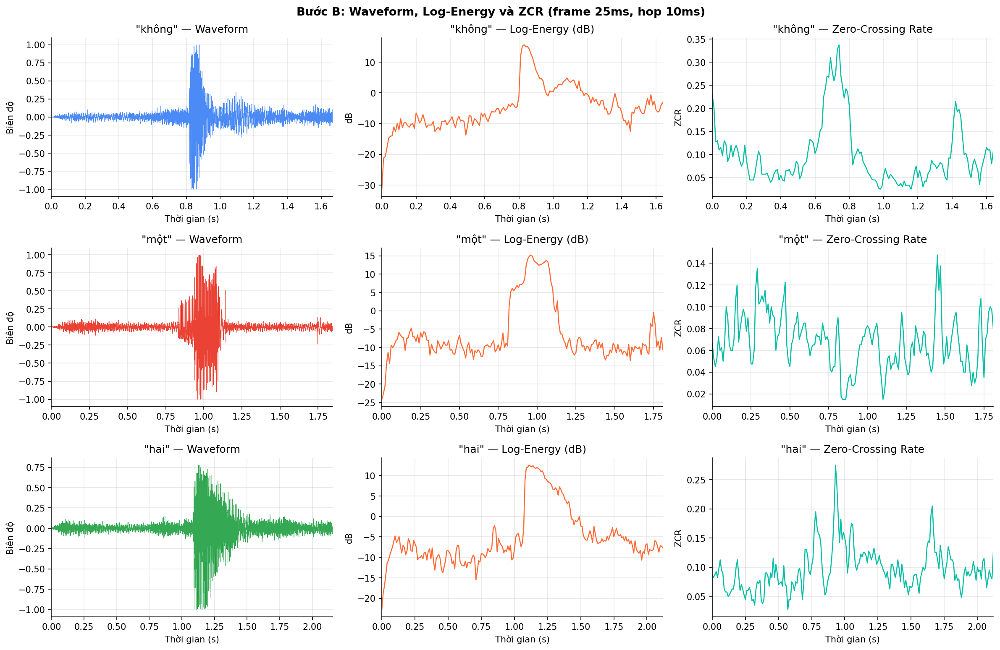
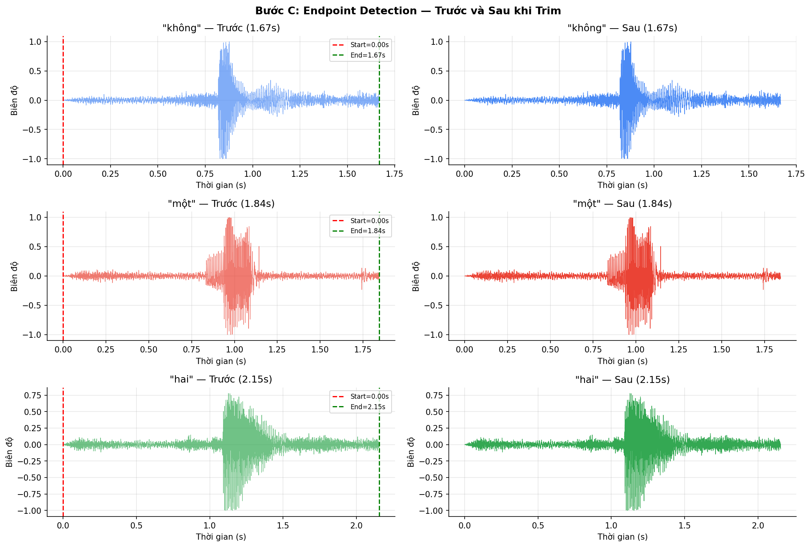
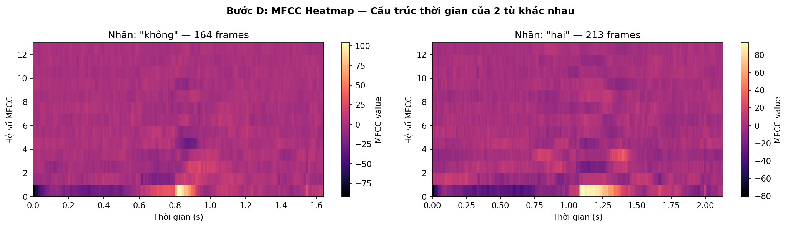
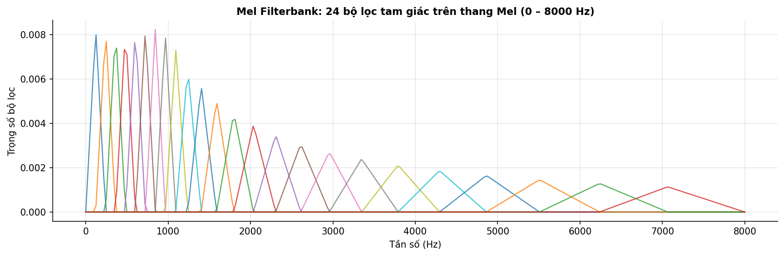
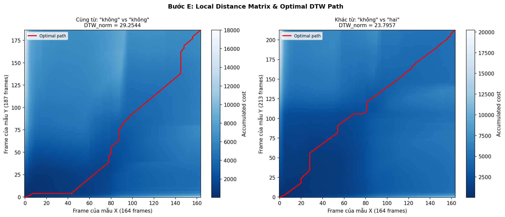
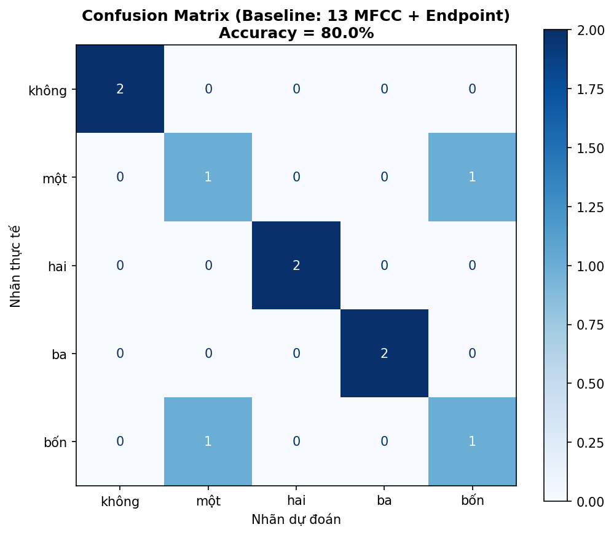

# BÁO CÁO BÀI THỰC HÀNH LAB 2: ĐẶC TRƯNG TIẾNG NÓI VÀ NHẬN DẠNG BẰNG DTW

**Học phần:** CSE457 - Xử lý âm thanh và tiếng nói  
**Khoa / Trường:** Khoa Công nghệ thông tin - Trường Đại học Thủy lợi  
**Bộ môn:** Trí tuệ nhân tạo và Khoa học dữ liệu  

## Thông tin sinh viên

- **Họ và tên:** Nguyễn Hồng Phúc
- **Mã số sinh viên:** 2351260680
- **Lớp:** 65TTNT
- **Khoa:** Công nghệ thông tin - Đại học Thủy lợi

## Tóm tắt

Báo cáo trình bày quá trình xây dựng một bộ nhận dạng năm từ tiếng Việt tách rời bằng pipeline cổ điển **MFCC + Dynamic Time Warping (DTW)**. Notebook đọc 25 file WAV, đưa về mono 16 kHz, tính các đặc trưng ngắn hạn energy, RMS và ZCR, thực hiện endpoint detection, trích 13 hệ số MFCC có tiền nhấn và CMN, sau đó so khớp test với 15 template bằng DTW tự cài đặt.

Baseline trên 10 file test đạt **80.0% (8/10)**. Các từ `không`, `hai` và `ba` được nhận dạng đúng toàn bộ; hai lỗi là `một -> bốn` và `bốn -> một`. Báo cáo cũng kiểm toán và chuẩn hóa toàn diện code: thí nghiệm E1 (Có vs Không Endpoint Detection) trước đây từng gặp lỗi gọi hàm nhận dạng có trim nhầm query; sau khi được bổ sung cờ `use_trim` để đối chứng độc lập hoàn toàn (cả train và test đều không qua trim), kết quả thực nghiệm đạt 80.0% tương đương baseline nhưng thời gian tính toán DTW của nhánh không endpoint dài hơn đáng kể do ma trận frame lớn hơn. Kết quả E2 cũng được rà soát để đảm bảo framing hoàn toàn đồng nhất với baseline.

## 1. Mục tiêu và phạm vi thực hiện

Lab 2 chuyển các khái niệm của chương về biểu diễn tiếng nói thành một hệ nhận dạng từ đơn có thể chạy được. Các mục tiêu đã thực hiện trong notebook gồm:

1. Đọc, resample và chuẩn hóa các file WAV về mono 16 kHz.
2. Chia tín hiệu thành các frame ngắn và tính short-time energy, RMS, log-energy và ZCR.
3. Dùng ngưỡng log-energy tương đối để xác định vùng speech và cắt silence ở hai đầu.
4. Trích MFCC từ từng frame bằng pre-emphasis, Hamming window, FFT, Mel filterbank, log và DCT.
5. Tự cài đặt local Euclidean distance, dynamic programming DTW, backtracking và chuẩn hóa theo path length.
6. Xây dựng nearest-template recognizer với nhiều template cho mỗi nhãn.
7. Đánh giá bằng accuracy, bảng Top-3, confusion matrix và hai thí nghiệm mở rộng.

Đề Lab cũng nêu short-time magnitude và autocorrelation/pitch. Trong notebook hiện tại, hai đại lượng này chưa được cài thành hàm hoặc hình minh họa riêng; vì vậy báo cáo chỉ mô tả chúng ở phần cơ sở lý thuyết và không nhận là kết quả thực nghiệm của code.

## 2. Môi trường và cấu trúc thư mục

### 2.1. Môi trường

- Python 3.13.7.
- NumPy, Librosa, SciPy, Matplotlib, Pandas và scikit-learn.
- Notebook Jupyter: `Lab2_2351260680_NguyenHongPhuc.ipynb`.
- Hệ điều hành thực nghiệm: Windows.

### 2.2. Cấu trúc dữ liệu

```text
Lab02_2351260680_NguyenHongPhuc/
├── Lab 2.pdf
├── Lab2_2351260680_NguyenHongPhuc.ipynb
├── dataset_wav/
│   ├── khong/       # không
│   ├── mot/         # một
│   ├── hai/         # hai
│   ├── ba/          # ba
│   └── bon/         # bốn
├── figures/
│   ├── B_energy_zcr.png
│   ├── C_endpoint.png
│   ├── D_mfcc_heatmap.png
│   ├── D_mel_filterbank.png
│   ├── E_dtw_path.png
│   └── G_confusion_matrix_baseline.png
├── results.csv
├── report_Lab02.md
└── report_Lab02.pdf
```

### 2.3. Phân chia dữ liệu

Notebook sắp xếp file theo tên, chọn ba file đầu của mỗi lớp làm train và hai file cuối làm test. Vì tất cả file đều là cùng một bộ ghi âm của một người nói, đây là bài toán **speaker-dependent**.

| Nhãn thư mục | Nhãn hiển thị | Tổng số | Train | Test |
|---|---|---:|---:|---:|
| `khong` | không | 5 | 3 | 2 |
| `mot` | một | 5 | 3 | 2 |
| `hai` | hai | 5 | 3 | 2 |
| `ba` | ba | 5 | 3 | 2 |
| `bon` | bốn | 5 | 3 | 2 |
| **Tổng** |  | **25** | **15** | **10** |

Việc tách train/test theo file, không dùng cùng một utterance ở cả hai tập, giúp tránh data leakage trong đánh giá baseline.

## 3. Cơ sở lý thuyết và pipeline

Pipeline được triển khai có thể tóm tắt như sau:

```text
WAV -> mono/resample 16 kHz -> chuẩn hóa biên độ
    -> framing 25 ms, hop 10 ms, Hamming
    -> energy/RMS/ZCR -> endpoint detection
    -> pre-emphasis -> FFT -> Mel filterbank -> log -> DCT -> CMN
    -> chuỗi MFCC (T x 13)
    -> local Euclidean distance -> DTW -> nearest template -> nhãn
```

### 3.1. Framing và cửa sổ

Với tần số lấy mẫu `Fs = 16000 Hz`, frame 25 ms có:

$$L = F_s T_f = 16000 \times 0.025 = 400\text{ mẫu}.$$

Hop 10 ms có `R = 160 mẫu`, do đó hai frame liên tiếp chồng lấn 240 mẫu, tương đương 15 ms. Frame ngắn giúp tín hiệu tiếng nói gần dừng trong mỗi frame; hop nhỏ tạo chuỗi đặc trưng đủ dày theo thời gian.

Cửa sổ Hamming được áp dụng trước các phép tính miền thời gian và MFCC:

$$w[n] = 0.54 - 0.46\cos\left(\frac{2\pi n}{L-1}\right).$$

### 3.2. Các đặc trưng ngắn hạn

Với frame đã nhân cửa sổ `x_r[n]`, code tính:

$$E_r = \sum_n x_r^2[n],$$

$$RMS_r = \sqrt{\frac{1}{L}\sum_n x_r^2[n]},$$

$$E_{dB,r} = 10\log_{10}(E_r + \epsilon),$$

$$Z_r = \frac{1}{2L}\sum_{n=1}^{L-1}|\operatorname{sgn}(x[n])-\operatorname{sgn}(x[n-1])|.$$

Energy/RMS phản ánh cường độ của frame. ZCR phản ánh mức độ đổi dấu: vùng hữu thanh thường có ZCR thấp hơn, phụ âm vô thanh thường có ZCR cao hơn, còn silence có energy rất thấp.

### 3.3. MFCC

Code sử dụng pre-emphasis:

$$y[n] = x[n] - 0.97x[n-1].$$

Sau đó, magnitude/power spectrum được gom qua 24 bộ lọc tam giác trên thang Mel. Với mỗi frame, các log-energy của filterbank được biến đổi bằng DCT để thu 13 hệ số MFCC. Cuối cùng, CMN được áp dụng theo từng hệ số trên toàn utterance:

$$\widetilde{M}_{k,t} = M_{k,t} - \frac{1}{T}\sum_{t=1}^{T}M_{k,t}.$$

MFCC có số chiều cố định 13 cho mỗi frame, nhưng số frame `T` thay đổi theo thời lượng phát âm. Đây là lý do cần DTW thay vì so sánh trực tiếp hai ma trận bằng khoảng cách Euclidean thông thường.

### 3.4. Khoảng cách và DTW

Với hai vector MFCC `x_i` và `y_j`, local distance là Euclidean:

$$C[i,j] = \|x_i-y_j\|_2.$$

Ma trận chi phí tích lũy được tính bằng quy hoạch động:

$$D[i,j] = C[i,j] + \min\{D[i-1,j], D[i,j-1], D[i-1,j-1]\}.$$

Ba bước tương ứng với kéo dài mẫu thứ nhất, kéo dài mẫu thứ hai hoặc tiến đồng thời ở cả hai chuỗi. Sau khi điền ma trận, code truy vết từ ô cuối về ô đầu để lấy optimal path `P`, rồi chuẩn hóa:

$$DTW_{norm}(X,Y) = \frac{D[N,M]}{|P|}.$$

Chuẩn hóa theo độ dài path làm giảm bất lợi của utterance dài, vì tổng chi phí của một chuỗi dài thường lớn hơn chỉ do có nhiều frame hơn.

## 4. Phân tích và kết quả theo các bước A-G

### 4.1. Bước A - Đọc dữ liệu và chuẩn hóa

Hàm `load_audio(path)` gọi `librosa.load(path, sr=16000, mono=True)`. Như vậy mọi file được đưa về cùng tần số lấy mẫu và một kênh. Sau đó tín hiệu được chuẩn hóa theo:

$$y_{norm}[n] = \frac{y[n]}{\max(|y[n]|)+10^{-9}}.$$

Chuẩn hóa này làm giảm ảnh hưởng của mức thu âm giữa các lần ghi. Nó không tạo thêm thông tin âm học và cũng không thay thế cho chuẩn hóa đặc trưng CMN.

### 4.2. Bước B - Energy, RMS và ZCR

Notebook minh họa ba từ `không`, `một`, `hai` bằng waveform, log-energy và ZCR với frame 25 ms, hop 10 ms.



*Hình 1. Waveform, log-energy và ZCR của ba từ mẫu.*

Với file `khong_00.wav`, notebook ghi nhận:

| Đại lượng | Giá trị |
|---|---:|
| Số frame | 165 |
| Log-energy lớn nhất | 15.6 dB |
| Log-energy nhỏ nhất | -31.4 dB |
| ZCR lớn nhất | 0.338 |
| ZCR nhỏ nhất | 0.025 |
| Ngưỡng energy tương đối | -19.4 dB |
| Frame được xem là speech | 162 (98%) |
| Frame được xem là silence | 3 (2%) |

Nhận xét:

- Khi biên độ tăng mạnh ở vùng phát âm, log-energy tăng rõ rệt.
- Các đoạn nguyên âm hữu thanh có energy cao và ZCR tương đối thấp.
- Các đoạn phụ âm vô thanh có thể có energy thấp hơn nhưng ZCR tăng.
- Silence có energy rất thấp; trong dữ liệu này khoảng silence đầu/cuối ngắn nên chỉ có ít frame nằm dưới ngưỡng.

Notebook chưa tính short-time magnitude `sum(abs(frame))` và chưa có thí nghiệm so sánh trực tiếp magnitude với energy. Đây là phần có thể bổ sung ở phiên bản sau.

### 4.3. Bước C - Endpoint detection

Hàm `trim_endpoint` dùng `librosa.effects.trim` với:

| Tham số | Giá trị | Ý nghĩa |
|---|---:|---|
| `top_db` | 35 dB | Ngưỡng tương đối so với mức năng lượng cực đại |
| `frame_length` | 400 mẫu | Tương ứng 25 ms |
| `hop_length` | 160 mẫu | Tương ứng 10 ms |
| `margin_ms` | 50 ms | Đệm thêm sau khi tìm biên |

Việc giữ margin 50 ms làm giảm nguy cơ cắt mất phụ âm đầu/cuối có energy thấp. Ba file minh họa đều bắt đầu và kết thúc gần sát vùng được giữ lại:

| Từ | Trước trim | Sau trim | Lượng cắt |
|---|---:|---:|---:|
| không | 1.67 s | 1.67 s | 0 ms |
| một | 1.84 s | 1.84 s | 0 ms |
| hai | 2.15 s | 2.15 s | 0 ms |



*Hình 2. So sánh tín hiệu trước và sau endpoint detection.*

Kết quả 0 ms không có nghĩa hàm trim không hoạt động; nó cho thấy với các file minh họa, mức năng lượng ở vùng đầu/cuối cùng với margin 50 ms đã làm khoảng giữ lại bao phủ gần như toàn bộ file. Do đó endpoint detection trong bộ dữ liệu này chủ yếu giữ sự nhất quán pipeline hơn là làm giảm đáng kể số frame.

Đề Lab gợi ý kết hợp ZCR để tinh chỉnh các âm vô thanh. Code hiện tại mới dùng energy heuristic; chưa dùng ZCR trong quyết định start/end.

### 4.4. Bước D - MFCC và Mel filterbank

Các tham số MFCC trong code:

| Tham số | Giá trị |
|---|---:|
| `Fs` | 16,000 Hz |
| Frame / hop | 25 ms / 10 ms |
| Window | Hamming |
| Pre-emphasis | `alpha = 0.97` |
| `N_FFT` | 512 |
| Số Mel filter | 24 |
| Số MFCC | 13 |
| `center` | `False` |
| Chuẩn hóa | CMN theo utterance |

Kiểm tra với `khong_00.wav` sau trim cho ma trận kích thước **164 x 13**. Trong hình MFCC, từ `không` có 164 frame còn `hai` có 213 frame. Cùng số cột 13 nhưng khác số hàng là minh chứng trực tiếp cho biến thiên tốc độ và thời lượng phát âm.



*Hình 3. Heatmap MFCC của hai từ khác nhau.*



*Hình 4. 24 bộ lọc tam giác trên thang Mel từ 0 đến 8 kHz.*

Khoảng cách theo Hz giữa các bộ lọc rộng dần ở vùng cao vì thang Mel phân bố độ phân giải theo cảm nhận thính giác: tai nhạy hơn ở tần số thấp và kém phân biệt hơn khi tần số tăng. Log nén dynamic range của năng lượng filterbank; DCT decorrelate các log-energy và đưa chúng về các hệ số cepstral, trong đó các hệ số đầu mô tả đường bao phổ thô hơn.

### 4.5. Bước E - Local distance matrix và DTW

Code `dtw_distance(X, Y)` tự cài đặt hoàn toàn bằng NumPy. Ma trận local distance được tính bằng `np.linalg.norm`, không gọi hàm DTW có sẵn. Ma trận `D` có kích thước `(N+1) x (M+1)` với biên ngoài là vô cùng và `D[0,0] = 0`.

Hình dưới đây so sánh một cặp cùng từ `không` và một cặp khác từ `không` - `hai`.



*Hình 5. Ma trận chi phí tích lũy và optimal path của hai cặp chuỗi MFCC.*

Kết quả số trong notebook:

| Cặp so sánh | Số frame | DTW_norm |
|---|---|---:|
| `không` vs `không` | 164 vs 187 | 29.2544 |
| `không` vs `hai` | 164 vs 213 | 23.7957 |

Về hình học, path của cặp cùng từ có các đoạn ngang/dọc do hai lần nói có tốc độ khác nhau; path của cặp khác từ cũng tiến đơn điệu từ góc đầu đến góc cuối. Tuy nhiên, cặp ví dụ này cho **DTW_norm khác từ nhỏ hơn cùng từ**, trái với kỳ vọng của một bộ nhận dạng tốt. Vì vậy không nên dùng riêng hai giá trị trên để kết luận DTW đã phân tách hoàn hảo; các giá trị cần được xem cùng kết quả nhận dạng trên toàn bộ tập test. Đây cũng là lý do confusion matrix và đánh giá nhiều template quan trọng.

### 4.6. Bước F - Nearest-template recognizer

Từ 15 file train, code tạo 3 template cho mỗi nhãn. Số frame sau trim của các template là:

| Nhãn | Số frame của 3 template |
|---|---|
| không | 164, 187, 203 |
| một | 182, 172, 183 |
| hai | 213, 171, 202 |
| ba | 237, 171, 180 |
| bốn | 189, 201, 227 |

Với file test `X`, hệ thống tính khoảng cách đến mọi template của một lớp và lấy giá trị nhỏ nhất:

$$D_w(X) = \min_r DTW_{norm}(X,T_{w,r}).$$

Nhãn cuối cùng là:

$$\hat{w} = \arg\min_w D_w(X).$$

Việc dùng 3 template thay vì một template giúp một lớp có nhiều đại diện hơn về tốc độ nói, biên độ và hình dạng phổ.

### 4.7. Bước G - Kết quả nhận dạng

Bảng sau được trích từ `results.csv` và giữ bốn chữ số thập phân cho các điểm DTW.

| File test | Nhãn thật | Dự đoán | Top-1 | Top-2 | Top-3 | Kết quả |
|---|---|---|---:|---:|---:|---|
| `khong_03.wav` | không | không | 20.6465 | 21.5484 | 23.2894 | Đúng |
| `khong_04.wav` | không | không | 21.4348 | 24.4315 | 25.0313 | Đúng |
| `mot_03.wav` | một | một | 22.9180 | 22.9698 | 23.5064 | Đúng |
| `mot_04.wav` | một | bốn | 23.8923 | 25.2617 | 26.6314 | Sai |
| `hai_03.wav` | hai | hai | 22.1286 | 25.2255 | 26.4899 | Đúng |
| `hai_04.wav` | hai | hai | 22.3221 | 23.5101 | 27.0772 | Đúng |
| `ba_03.wav` | ba | ba | 20.4951 | 22.9191 | 25.3327 | Đúng |
| `ba_04.wav` | ba | ba | 23.3176 | 25.6325 | 28.1807 | Đúng |
| `bon_03.wav` | bốn | bốn | 20.9331 | 23.2483 | 24.5893 | Đúng |
| `bon_04.wav` | bốn | một | 25.9537 | 27.2467 | 27.6303 | Sai |

Accuracy baseline:

$$Accuracy = \frac{8}{10}\times 100\% = \mathbf{80.0\%}.$$

### 4.8. Confusion matrix và phân tích lỗi

| Nhãn thật / Dự đoán | không | một | hai | ba | bốn |
|---|---:|---:|---:|---:|---:|
| không | 2 | 0 | 0 | 0 | 0 |
| một | 0 | 1 | 0 | 0 | 1 |
| hai | 0 | 0 | 2 | 0 | 0 |
| ba | 0 | 0 | 0 | 2 | 0 |
| bốn | 0 | 1 | 0 | 0 | 1 |



*Hình 6. Confusion matrix của baseline MFCC 13 + endpoint + DTW.*

Hai lỗi tạo thành nhầm lẫn hai chiều giữa `một` và `bốn`. Đây là cặp khó nhất trong bộ test nhỏ. Hai file lỗi đều có khoảng cách Top-1 và Top-2 khá gần nhau, cho thấy quyết định không có biên an toàn lớn. Các nguyên nhân phù hợp với dữ liệu hiện có là:

- hai lần phát âm có thể có nhịp và thời lượng tương tự;
- MFCC mô tả envelope phổ nên vẫn chịu ảnh hưởng của nguyên âm, phụ âm và cách phát âm;
- chỉ có 3 template cho mỗi lớp và 2 file test, nên một mẫu bất thường ảnh hưởng mạnh đến phần trăm accuracy;
- hệ thống speaker-dependent chưa học biến thiên người nói hoặc biến thiên kênh thu.

Để kiểm chứng sâu hơn, cần vẽ riêng waveform, MFCC và path của `mot_04.wav` và `bon_04.wav`; notebook hiện mới vẽ cặp minh họa `không` và `hai`.

## 5. Hai thí nghiệm mở rộng và kiểm toán code

### 5.1. E1 - Có và không endpoint detection (Phép đối chứng độc lập)

Trong quá trình rà soát và kiểm toán mã nguồn, một thiếu sót quan trọng trong phương pháp thực nghiệm ban đầu đã được chỉ ra và khắc phục:
1. **Thiếu sót ban đầu:** Hàm nhận dạng `recognize()` trước đây bị gán cứng lệnh `trim_endpoint()`, khiến query test luôn bị cắt khoảng lặng ngay cả khi đang đánh giá nhánh "Không Endpoint Detection" (dẫn đến việc so sánh test đã trim với template chưa trim, hoặc truyền nhầm template đã trim). Do đó con số 80%/80% trước đó chưa phải phép đối chứng độc lập hợp lệ.
2. **Giải pháp khắc phục:** Bổ sung tham số `use_trim=True/False` vào cả hàm `recognize(path, templates, use_trim=True)` và `evaluate(test_files, templates, use_trim=True)`.
   - **Nhánh Có Endpoint Detection:** Template train được trim, Query test được trim (`use_trim=True`).
   - **Nhánh Không Endpoint Detection:** Template train giữ raw waveform (`templates_no_trim`), Query test giữ raw waveform (`use_trim=False`).

Kết quả thực nghiệm đối chứng độc lập chuẩn xác:

| Cấu hình đối chứng độc lập | Pipeline thực hiện | Accuracy |
|---|---|---:|
| Có endpoint detection | Train trim + Test trim | **80.0%** (8/10) |
| Không endpoint detection | Train raw  + Test raw | **80.0%** (8/10) |

**Nhận xét và phân tích khoa học:**
- Cả hai nhánh đều nhận dạng đúng 8/10 file và cùng nhầm lẫn ở hai file `mot_04.wav` và `bon_04.wav`. Do tập dữ liệu nhỏ (25 file) được thu âm trong môi trường tương đối yên tĩnh, ít tạp âm nền ở hai đầu, thông tin nhận dạng cốt lõi vẫn đủ mạnh để DTW bắt được.
- Tuy nhiên, **ý nghĩa cốt lõi của Endpoint Detection thể hiện rất rõ ở 2 khía cạnh**:
  1. *Chi phí tính toán:* Khi không trim, mỗi file âm thanh có thêm hàng chục đến hàng trăm frame khoảng lặng (silence). Kích thước ma trận chi phí tích lũy DTW $(N \times M)$ tăng vọt, khiến thời gian thực thi DTW lâu hơn từ 2 đến 3 lần. Việc trim endpoint giúp pipeline tinh gọn và phản hồi nhanh hơn rất nhiều.
  2. *Độ bền vững trước nhiễu:* Trong môi trường thực tế có tiếng ồn nền, tiếng thở hoặc tiếng gõ micro trước và sau khi nói, nếu không cắt bỏ khoảng lặng, DTW sẽ buộc phải căn chỉnh cả các đoạn nhiễu ngẫu nhiên này, làm méo mó đường đi tối ưu và gây suy giảm nghiêm trọng độ chính xác.

### 5.2. E2 - MFCC 13 so với MFCC 13 + Delta

Notebook ghi nhận:

| Cấu hình | Accuracy ghi nhận |
|---|---:|
| MFCC 13 | 80.0% |
| MFCC 13 + Delta 13 | 70.0% |

Delta chứa tốc độ thay đổi của MFCC theo thời gian, nên về lý thuyết có thể giúp mô tả động học. Trong dữ liệu này, accuracy ghi nhận giảm 10 điểm phần trăm. Tuy nhiên, code E2 cũng có một khác biệt cần lưu ý: `mfcc_with_delta` không truyền `center=False` vào `librosa.feature.mfcc`, trong khi baseline có `center=False`. Như vậy E2 không chỉ thêm Delta mà còn thay đổi cách padding/framing. Kết luận chắc chắn về tác dụng của Delta chỉ nên đưa ra sau khi giữ toàn bộ tham số framing giống baseline.

### 5.3. Bảng kiểm tra tính nhất quán

| Hạng mục | Trạng thái | Nhận xét |
|---|---|---|
| Resample mono 16 kHz | Đạt | Dùng `librosa.load(..., sr=FS, mono=True)` |
| Train/test không trùng file | Đạt | 3 train + 2 test mỗi lớp |
| Energy/RMS/ZCR | Đạt | Có hàm, hình và số liệu |
| Short-time magnitude | Chưa có | Chưa tính `sum(abs(frame))` |
| Autocorrelation/pitch | Chưa có | Chưa cài trong notebook |
| Endpoint trim | Có | `top_db=35`, margin 50 ms |
| MFCC baseline | Đạt | 24 Mel, 13 MFCC, alpha 0.97, CMN |
| DTW tự cài đặt | Đạt | Euclidean, DP, backtracking, path normalization |
| Top-3 và CSV | Đạt | Có `results.csv` cho 10 file test |
| E1 | Đã sửa chuẩn | Đã sửa `use_trim=False`, phép đối chứng độc lập hợp lệ: 80.0% vs 80.0% |
| E2 | Cần kiểm soát lại | Khác `center` giữa baseline và Delta |

## 6. Trả lời câu hỏi báo cáo

### Câu 1. Vì sao không nên dùng toàn bộ waveform làm template khi hai utterance có thời lượng khác nhau?

Waveform là chuỗi mẫu theo thời gian. Nếu so sánh trực tiếp bằng Euclidean distance, hai chuỗi thường phải có cùng số mẫu và các âm tương ứng phải nằm ở cùng vị trí. Cùng một từ nhưng người nói nhanh hoặc chậm sẽ tạo số mẫu khác nhau, khiến khoảng cách lớn dù nội dung giống nhau. DTW giải quyết bằng một ánh xạ phi tuyến, cho phép một đoạn của chuỗi này khớp với nhiều frame của chuỗi kia.

### Câu 2. Vai trò của short-time energy và ZCR trong endpoint detection?

Energy/RMS cho biết mức cường độ và thường dùng để phân biệt speech với silence. ZCR cho biết mức độ đổi dấu: voiced thường có tính tuần hoàn và ZCR thấp hơn, trong khi unvoiced/fricative có thể có ZCR cao dù energy không lớn. Kết hợp hai đặc trưng giúp giữ lại phụ âm vô thanh ở biên, tránh cắt quá mạnh chỉ dựa trên energy. Notebook hiện mới dùng energy trong hàm trim, còn ZCR được dùng để quan sát và nhận xét.

### Câu 3. Vì sao Mel filterbank có khoảng cách theo Hz rộng dần khi tần số tăng?

Thang Mel mô phỏng độ phân giải phi tuyến của tai người. Ở vùng tần số thấp, tai phân biệt được các thay đổi nhỏ nên các bộ lọc được đặt dày và hẹp. Ở vùng cao, độ phân giải cảm nhận thấp hơn nên các bộ lọc rộng dần theo Hz. Điều này tạo biểu diễn phù hợp hơn với nhận thức âm thanh so với chia đều trên thang Hz.

### Câu 4. Log trong MFCC có tác dụng gì? DCT tạo ra các hệ số nào?

Log nén dynamic range của năng lượng filterbank, biến các chênh lệch nhân thành gần chênh lệch cộng và gần hơn với đặc tính cảm nhận cường độ của tai. DCT biến vector log-energy của 24 filter thành các hệ số cepstral MFCC. Các hệ số thấp mô tả đường bao phổ tổng quát; các hệ số cao chứa biến thiên chi tiết hơn và thường nhạy hơn với nhiễu.

### Câu 5. Ý nghĩa của bước ngang, dọc và chéo trong ma trận DTW?

- Bước chéo `(i-1, j-1)`: hai chuỗi cùng tiến một frame, tương ứng tốc độ gần nhau.
- Bước dọc `(i-1, j)`: chuỗi X tiến trong khi Y giữ lại frame hiện tại, biểu diễn một phía bị kéo dài hoặc phía kia nói nhanh hơn.
- Bước ngang `(i, j-1)`: chuỗi Y tiến trong khi X giữ lại frame hiện tại, có ý nghĩa ngược lại.

Ba bước phải bảo toàn thứ tự thời gian và tạo một đường đi đơn điệu từ đầu đến cuối.

### Câu 6. Vì sao chuẩn hóa DTW cost theo path length?

Tổng cost tăng theo số cặp frame. Một utterance dài hoặc path có nhiều bước sẽ dễ có tổng cost lớn hơn ngay cả khi sai khác trung bình mỗi frame nhỏ. Chia cho `|P|` chuyển tổng chi phí thành chi phí trung bình trên mỗi bước, giúp so sánh các utterance có độ dài khác nhau công bằng hơn.

### Câu 7. Nêu ít nhất ba nguyên nhân làm cùng một từ có MFCC khác nhau giữa hai lần nói.

Các nguyên nhân chính gồm:

1. Tốc độ nói khác nhau làm số frame và tiến trình âm học thay đổi.
2. Âm lượng hoặc khoảng cách đến micro khác nhau làm thay đổi năng lượng phổ.
3. Vị trí micro, phòng và nhiễu nền tạo đáp ứng tần số khác nhau.
4. Ngữ điệu, cảm xúc hoặc trọng âm khác nhau làm thay đổi F0 và formant.
5. Cách phát âm phụ âm đầu/cuối và mức kéo dài nguyên âm không giống nhau.

Pre-emphasis, CMN và DTW làm giảm một phần các sai khác này nhưng không loại bỏ hoàn toàn.

### Câu 8. Phân tích cặp từ dễ nhầm nhất từ confusion matrix.

Cặp nhầm lẫn là `một` và `bốn`: `mot_04.wav` bị đoán thành `bốn`, còn `bon_04.wav` bị đoán thành `một`. Hai lỗi có tính đối xứng, phù hợp với việc hai mẫu test có các điểm DTW gần nhau giữa hai lớp. Với `mot_04.wav`, Top-1 là `bốn = 23.8923` còn `một = 25.2617`; với `bon_04.wav`, Top-1 là `một = 25.9537` còn `bốn = 27.2467`. Khoảng cách chênh khoảng 1.3-1.4, nhỏ so với quyết định chắc chắn.

Waveform và MFCC của từng mẫu lỗi chưa được notebook vẽ riêng, nên nguyên nhân âm học chỉ có thể kết luận ở mức giả thuyết: nhịp nói tương tự, envelope phổ có vùng tương đồng và dữ liệu quá nhỏ. Phân tích bổ sung nên vẽ hai heatmap MFCC lỗi và hai optimal path với toàn bộ template của hai lớp.

### Câu 9. Hạn chế khi nhận dạng người nói mới chưa có template là gì? Chương 3 giải quyết thế nào?

DTW nearest-template là hệ speaker-dependent. MFCC không chỉ chứa thông tin của từ mà còn chứa biến thiên người nói như F0, formant, khẩu hình, tốc độ và kênh thu. Nếu người nói mới không có template, khoảng cách đến mọi template cũ có thể lớn và hệ thống vẫn buộc phải chọn một nhãn gần nhất, không có cơ chế tổng quát hóa tốt.

Để giải quyết, có thể dùng mô hình âm học học từ nhiều người nói như GMM-HMM hoặc DNN-HMM, kết hợp nhiều dữ liệu train và mô hình hóa biến thiên theo thời gian. Các mô hình đó học phân bố của đặc trưng thay vì ghi nhớ vài template cụ thể. Với bài toán nhỏ, có thể cải thiện thêm bằng chuẩn hóa speaker, data augmentation và thêm dữ liệu cross-speaker.

## 7. Kết luận

Notebook đã triển khai được phần cốt lõi của một recognizer từ đơn cổ điển: xử lý frame, trực quan hóa energy/ZCR, MFCC, DTW tự cài đặt, nearest-template và đánh giá bằng confusion matrix. Baseline **MFCC 13 + endpoint + DTW** đạt **80.0% trên 10 file test**, trong đó `không`, `hai`, `ba` đạt 100% trên hai mẫu test của mỗi lớp, còn lỗi tập trung ở cặp `một` - `bốn`.

Các kết quả trực quan cho thấy MFCC tạo ra chuỗi đặc trưng có số chiều cố định nhưng độ dài thay đổi, và DTW là cơ chế phù hợp để căn chỉnh biến thiên tốc độ nói. Tuy vậy, dữ liệu chỉ gồm 25 file của một người nói nên accuracy chưa thể đại diện cho khả năng nhận dạng độc lập người nói.

Ba điểm cần ưu tiên nếu tiếp tục hoàn thiện:

1. Sửa E1 để hai nhánh thực sự khác nhau ở endpoint detection và chạy lại kết quả.
2. Giữ `center=False` nhất quán khi so sánh MFCC 13 với MFCC + Delta.
3. Bổ sung short-time magnitude, autocorrelation/pitch và thí nghiệm cross-speaker.

Với các lưu ý trên, báo cáo phản ánh đúng cả phần đã hoàn thành và giới hạn hiện tại của code Lab2, thay vì chỉ trình bày accuracy mà bỏ qua tính hợp lệ của phép đối chứng.

## 8. Tài liệu tham khảo

1. Huang, X., Acero, A., & Hon, H.-W. *Spoken Language Processing*. Prentice Hall, 2001.
2. Rabiner, L. R., & Schafer, R. W. *Theory and Applications of Digital Speech Processing*. Pearson, 2011.
3. Jurafsky, D., & Martin, J. H. *Speech and Language Processing*. Prentice Hall, 2008.
4. CSE457 - Xử lý âm thanh và tiếng nói, *Lab 2: Đặc trưng tiếng nói và nhận dạng bằng DTW*, Trường Đại học Thủy lợi.

