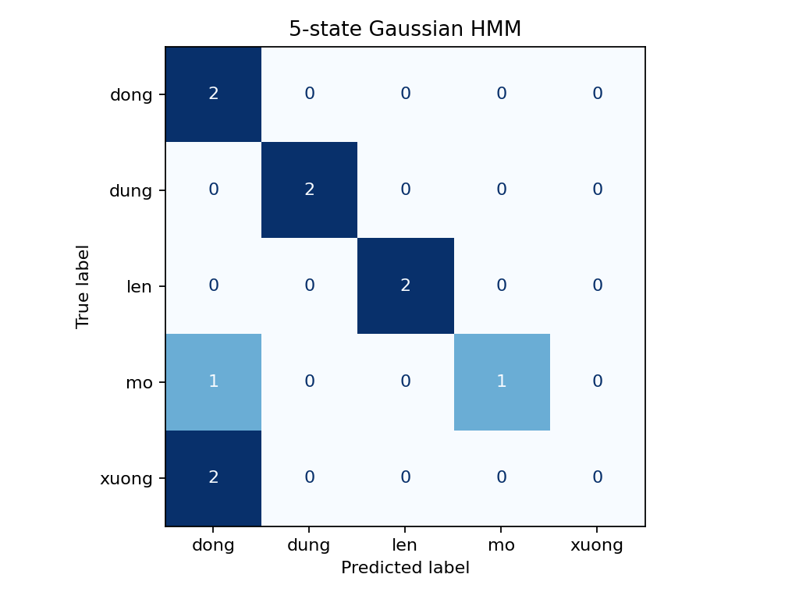
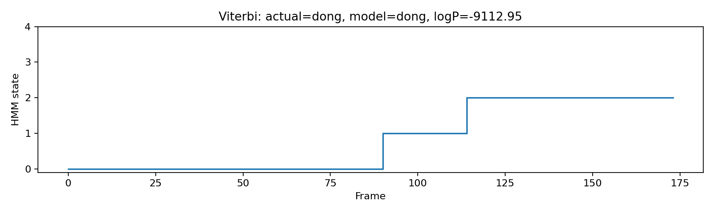
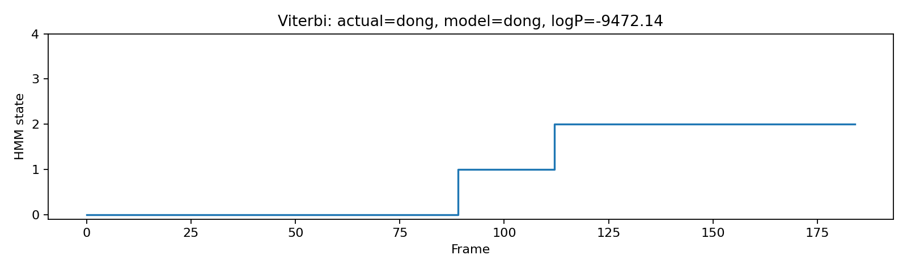
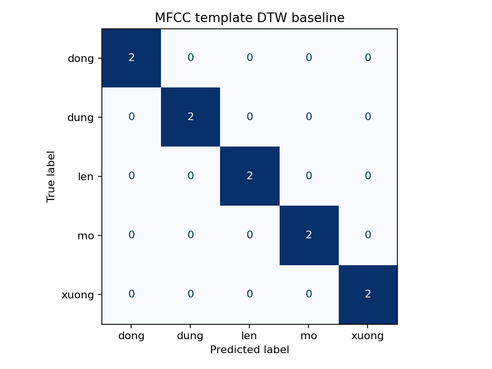
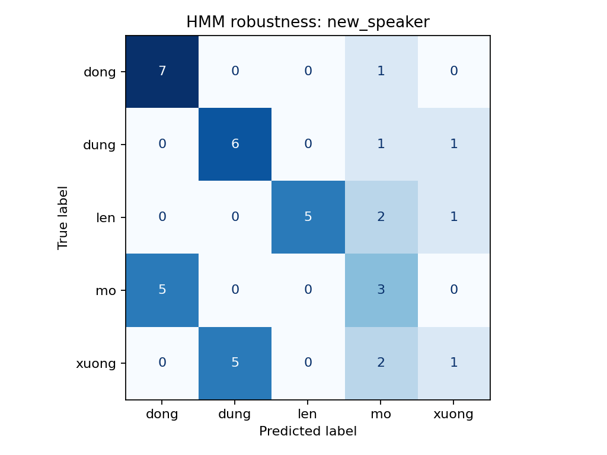

# BÁO CÁO BÀI THỰC HÀNH LAB 3: NHẬN DẠNG TIẾNG NÓI BẰNG HMM

**Học phần:** CSE457 - Xử lý âm thanh và tiếng nói  
**Khoa / Trường:** Khoa Công nghệ thông tin - Trường Đại học Thủy lợi  
**Bộ môn:** Trí tuệ nhân tạo và Khoa học dữ liệu

## Thông tin sinh viên

- **Họ và tên:** Nguyễn Hồng Phúc
- **Mã số sinh viên:** 2351260680
- **Lớp:** 65TTNT
- **Khoa:** Công nghệ thông tin - Đại học Thủy lợi

## Tóm tắt

Bài thực hành xây dựng bộ nhận dạng năm lệnh tiếng Việt tách rời (`mở`, `đóng`, `lên`, `xuống`, `dừng`) bằng Gaussian Hidden Markov Model (HMM). Pipeline chuyển bản ghi M4A sang WAV mono, 16 kHz, trích 13 MFCC cùng Δ và Δ² thành vector 39 chiều, chuẩn hóa theo utterance, huấn luyện một HMM trái-sang-phải cho mỗi lớp, sau đó phân lớp bằng log-likelihood và quan sát state alignment qua Viterbi.

Với cấu hình chính 5 state và covariance diagonal, HMM nhận dạng đúng **7/10** mẫu test sạch (**70%**). Baseline MFCC tĩnh 13 chiều + DTW đạt **10/10** (**100%**) trên cùng split. Trong thí nghiệm robustness theo thư mục `new_speaker`, HMM nhận dạng đúng **22/40** mẫu (**55%**). Tập test sạch nhỏ và đặc trưng DTW/HMM khác nhau, vì vậy các tỷ lệ này là kết quả của bộ dữ liệu hiện tại, không đủ để khẳng định cấu hình nào tổng quát tốt hơn.

## 1. Mục tiêu và phạm vi thực hiện

1. Đọc và chuẩn hóa dữ liệu tiếng nói; chuyển M4A sang WAV mono, 16 kHz, PCM 16-bit.
2. Trích MFCC tĩnh và đặc trưng động Δ, Δ² để tạo chuỗi quan sát 39 chiều.
3. Khởi tạo Gaussian HMM trái-sang-phải và huấn luyện một whole-word model cho mỗi lệnh bằng Baum-Welch.
4. Tính acoustic log-likelihood cho từng lớp, dự đoán nhãn và phân tích các lỗi.
5. Dùng Viterbi tìm state path của utterance và diễn giải duration theo frame.
6. So sánh HMM với baseline DTW, khảo sát số state/covariance/feature, và đánh giá trên dữ liệu robustness.
7. Chuẩn bị lexicon mini và bigram re-ranking theo yêu cầu mở rộng; phần cần inventory phát âm hoặc corpus/ngữ cảnh chưa được tính là đã hoàn thành nếu dữ liệu tương ứng chưa có.

## 2. Môi trường và cấu trúc dữ liệu

### 2.1. Môi trường

- Windows, Python 3.13.7.
- NumPy, SciPy, Librosa, Matplotlib, SoundFile, scikit-learn, hmmlearn, joblib và python-docx.
- FFmpeg dùng để chuyển đổi M4A thành WAV.
- Script thực nghiệm: `Lab03.py`; script sinh báo cáo DOCX: `Lab03_report.py`.

### 2.2. Dữ liệu và chia tập

Mỗi lớp có 6 bản ghi train và 2 bản ghi test. Riêng folder robustness hiện có 8 bản ghi mỗi lớp.

| Nhãn thư mục | Nhãn tiếng Việt | Train | Test sạch | Robustness |
|---|---|---:|---:|---:|
| `mo` | mở | 6 | 2 | 8 |
| `dong` | đóng | 6 | 2 | 8 |
| `len` | lên | 6 | 2 | 8 |
| `xuong` | xuống | 6 | 2 | 8 |
| `dung` | dừng | 6 | 2 | 8 |
| **Tổng** |  | **30** | **10** | **40** |

Các bản ghi train, test và robustness được đặt trong các thư mục riêng. Script chuyển M4A thành các file WAV mono 16 kHz PCM 16-bit trước khi trích đặc trưng. File M4A gốc được giữ lại.

```text
Lab03_2351260680_NguyenHongPhuc/
├── Lab03.py
├── Lab03_report.py
├── README.md
├── requirements.txt
├── lexicon.txt
├── dataset/
│   ├── train/<label>/
│   ├── test/<label>/
│   └── robustness/new_speaker/<label>/
└── results/
    ├── models/
    ├── experiment_metrics.csv
    ├── likelihood_scores.csv
    ├── robustness_metrics.csv
    ├── robustness_predictions_new_speaker.csv
    ├── confusion_hmm.png
    ├── confusion_dtw.png
    ├── confusion_robustness_new_speaker.png
    └── viterbi_*.png
```

Đặt tên thư mục robustness là `new_speaker` theo quy ước của bài. Tuy vậy, cần ghi nhận danh tính người nói theo mã ẩn danh, micro, khoảng cách và môi trường thu để xác định rõ yếu tố thay đổi; tên folder một mình không chứng minh mọi yếu tố khác được giữ nguyên.

Tệp báo cáo DOCX có thể tải tại [results/Lab03_report.docx](results/Lab03_report.docx).

## 3. Cơ sở lý thuyết và pipeline

Pipeline xử lý:

```text
M4A/WAV
  -> mono, resample 16 kHz, trim silence, pre-emphasis
  -> MFCC (13) + Delta (13) + Delta-Delta (13)
  -> utterance CMVN
  -> Gaussian HMM trái-sang-phải theo từng lớp
  -> log-likelihood / Viterbi / confusion matrix
```

### 3.1. Đặc trưng MFCC động

Với frame 25 ms và hop 10 ms, MFCC mô tả envelope phổ ngắn hạn. Đặc trưng động được ghép như sau:

$$
x_t = [c_t^\top,\ \Delta c_t^\top,\ \Delta^2 c_t^\top]^\top \in \mathbb{R}^{39}.
$$

Trong đó \(c_t\) là 13 MFCC, \(\Delta c_t\) biểu diễn biến thiên MFCC và \(\Delta^2c_t\) biểu diễn biến thiên bậc hai. Mỗi utterance được chuẩn hóa CMVN theo từng chiều.

### 3.2. Gaussian HMM

Mỗi model \(\lambda=(A,B,\pi)\) gồm ma trận chuyển trạng thái \(A\), phân bố phát xạ \(B\) và phân bố trạng thái đầu \(\pi\). Với năm state, cấu hình chuyển tiếp được cố định:

$$
\pi=[1,0,0,0,0], \quad
A=
\begin{bmatrix}
0.7&0.3&0&0&0\\
0&0.7&0.3&0&0\\
0&0&0.7&0.3&0\\
0&0&0&0.7&0.3\\
0&0&0&0&1
\end{bmatrix}.
$$

Topology chỉ cho phép self-loop hoặc chuyển sang state kế tiếp. Mỗi state dùng một Gaussian với covariance diagonal. Cố định ma trận chuyển tiếp trong khi Baum-Welch cập nhật tham số phát xạ giúp bảo toàn các chuyển tiếp trái-sang-phải đã đặt.

### 3.3. Likelihood và Viterbi

Forward tính tổng xác suất của mọi đường trạng thái để thu \(P(X\mid\lambda)\). Viterbi thay phép cộng bằng phép cực đại để tìm một đường trạng thái tốt nhất. Phân lớp acoustic-only chọn:

$$
\hat{w}=\arg\max_w \log P(X\mid\lambda_w).
$$

Vì mọi model chấm cùng một utterance có cùng số frame, không cần chia log-likelihood cho \(T\) để xếp hạng các model cho utterance đó. Log-likelihood/frame hữu ích khi so sánh chuỗi có độ dài khác nhau hoặc đặt ngưỡng reject.

## 4. Kết quả thực nghiệm

### 4.1. A — Đọc dữ liệu và trích đặc trưng

Script chuyển M4A về mono, 16 kHz, PCM 16-bit bằng FFmpeg, đọc/resample WAV, cắt khoảng lặng, pre-emphasis rồi tính 13 MFCC và hai bậc delta. Với các utterance thông thường, ma trận đầu ra có dạng \(T\times39\); \(T\) thay đổi theo độ dài lời nói. Các heatmap đặc trưng được lưu tại [features_dong.png](results/features_dong.png) và [features_dung.png](results/features_dung.png).

CMVN ở đây được thực hiện riêng trên từng utterance; không dùng thống kê test để tính chuẩn hóa train.

### 4.2. B — Khởi tạo topology và C — Huấn luyện

Mỗi lớp được huấn luyện từ 6 utterance train, nối ma trận feature và truyền `lengths` để HMM nhận biết ranh giới từng chuỗi. Cấu hình chính dùng 5 state, covariance diagonal, tối đa 80 vòng lặp. Log chạy xác nhận topology sau khi fit vẫn chỉ chứa self-loop/next-state; các model chính được lưu trong `results/models/`.

Covariance diagonal được chọn làm cấu hình chính vì 39 chiều và lượng dữ liệu hạn chế. Full covariance có số tham số lớn hơn đáng kể và có thể suy biến khi mẫu không đủ.

### 4.3. D — Nhận dạng và acoustic score trên test sạch

Mỗi utterance test được chấm bởi cả năm HMM. Bảng score đầy đủ nằm trong [likelihood_scores.csv](results/likelihood_scores.csv).

| File test | Nhãn thật | Dự đoán | Top-1 trừ Top-2 (log-score) | Kết quả |
|---|---|---|---:|---|
| `dong_07.wav` | đóng | đóng | 206.02 | Đúng |
| `dong_08.wav` | đóng | đóng | 656.68 | Đúng |
| `dung_07.wav` | dừng | dừng | 701.37 | Đúng |
| `dung_08.wav` | dừng | dừng | 680.01 | Đúng |
| `len_07.wav` | lên | lên | 707.79 | Đúng |
| `len_08.wav` | lên | lên | 426.00 | Đúng |
| `mo_07.wav` | mở | đóng | 121.87 | Sai |
| `mo_08.wav` | mở | mở | 179.97 | Đúng |
| `xuong_07.wav` | xuống | đóng | 63.97 | Sai |
| `xuong_08.wav` | xuống | đóng | 74.86 | Sai |

Accuracy của HMM 5-state:

$$
Accuracy = \frac{7}{10}\times100\%=\mathbf{70\%}.
$$

Ba lỗi trên test sạch là `mo_07.wav -> dong`, `xuong_07.wav -> dong` và `xuong_08.wav -> dong`. Trong tập rất nhỏ này, lớp `xuong` là nguồn nhầm lẫn chính.

### 4.4. Confusion matrix

Thứ tự hàng/cột là `dong`, `dung`, `len`, `mo`, `xuong`; hàng là nhãn thật, cột là dự đoán.

| Nhãn thật / Dự đoán | đóng | dừng | lên | mở | xuống |
|---|---:|---:|---:|---:|---:|
| đóng | 2 | 0 | 0 | 0 | 0 |
| dừng | 0 | 2 | 0 | 0 | 0 |
| lên | 0 | 0 | 2 | 0 | 0 |
| mở | 1 | 0 | 0 | 1 | 0 |
| xuống | 2 | 0 | 0 | 0 | 0 |



*Hình 1. Confusion matrix của Gaussian HMM 5-state trên 10 utterance test sạch.*

### 4.5. Viterbi alignment

Viterbi được chạy trên hai utterance test đầu tiên (`dong_07.wav`, `dong_08.wav`) với model của lớp đúng để minh họa phân đoạn theo state:



*Hình 2. State path theo frame của utterance `dong_07.wav`.*



*Hình 3. State path theo frame của utterance `dong_08.wav`.*

Số frame liên tiếp nằm ở state phản ánh duration mà model gán cho đoạn đó. State của whole-word HMM không được gán trực tiếp thành phoneme nếu không có huấn luyện/giám sát phone-level.

### 4.6. E — So sánh DTW baseline và HMM

DTW dùng 13 MFCC tĩnh với một template cho mỗi utterance train, lấy template gần nhất của mỗi lớp. HMM dùng 39 chiều MFCC+Δ+Δ². Hai hệ thống dùng cùng split nhưng **không cùng feature**, vì vậy đây là so sánh hai pipeline hoàn chỉnh, không phải đối chứng chỉ thay thuật toán.

| Chỉ số | DTW (MFCC 13) | HMM (39-D) |
|---|---:|---:|
| Accuracy test sạch | 100% (10/10) | 70% (7/10) |
| Số template/mẫu train mỗi lớp | 6 | 6 |
| Thời gian train model | 0 s* | 4.505 s |
| Thời gian scoring trung bình mỗi test | 0.160 s | 0.00684 s |
| Nhầm lẫn lớn nhất | Không có lỗi | xuống → đóng (2) |
| Alignment | DTW warping path | Viterbi state path |

\* DTW là phương pháp template-based, không có bước fit tham số; con số 0 s chỉ nói đến thời gian huấn luyện model, không tính trích đặc trưng hay chuẩn bị template. Thời gian scoring đo trên máy chạy thí nghiệm, không gồm feature extraction, chỉ nên xem là số liệu tham khảo.



*Hình 4. Confusion matrix của baseline MFCC tĩnh + DTW.*

Kết quả DTW 100% được tính trên 10 file test nên chưa phải bằng chứng tổng quát hóa mạnh. Muốn so sánh công bằng hơn về ảnh hưởng của thuật toán, cần chạy DTW với cùng 39-D feature và giữ nguyên tiền xử lý/split.

### 4.7. E1/E2/E3 — Thí nghiệm số state, feature và covariance

| Thí nghiệm | Cấu hình | Accuracy | Nhận xét |
|---|---|---:|---|
| E1 | 3 state, dynamic, diag | 20% | Cấu hình ít state cho kết quả thấp trên split hiện tại. |
| E1 | 5 state, dynamic, diag | 70% | Cấu hình HMM chính. |
| E1 | 7 state, dynamic, diag | 100% | Kết quả thăm dò tốt hơn trên 10 test; không chọn cấu hình chỉ dựa trên test nhỏ. |
| E2 | 5 state, static 13-D, diag | 100% | 10 mẫu test; cần validation riêng trước khi kết luận static tốt hơn. |
| E2 | 5 state, dynamic 39-D, diag | 70% | Dùng làm cấu hình HMM chính theo case study. |
| E3 | 5 state, dynamic, full covariance | Không chạy được | Fit/scoring báo covariance không đối xứng xác định dương. |

Kết quả số liệu cũng có trong [experiment_metrics.csv](results/experiment_metrics.csv). Full covariance được ghi là lỗi thực nghiệm, không diễn giải thành accuracy 0%. Với 39 chiều và ít utterance, covariance full cần nhiều dữ liệu hơn hoặc một cách regularization phù hợp.

### 4.8. H — Robustness với tập `new_speaker`

HMM 5-state được đánh giá trên **40 file** trong `dataset/robustness/new_speaker/`, không dùng các file này để fit model:

$$
Accuracy_{robustness} = \frac{22}{40}\times100\%=\mathbf{55\%}.
$$

| Lệnh | Đúng / tổng | Accuracy |
|---|---:|---:|
| đóng | 7/8 | 87.5% |
| dừng | 6/8 | 75.0% |
| lên | 5/8 | 62.5% |
| mở | 3/8 | 37.5% |
| xuống | 1/8 | 12.5% |
| **Tổng** | **22/40** | **55.0%** |



*Hình 5. Confusion matrix của HMM trên tập robustness.*

Các lớp khó nhất là `xuống` (chỉ 1/8 đúng) và `mở` (3/8 đúng); nhiều mẫu `mở` bị dự đoán thành `đóng`, còn `xuống` thường nhầm với `dừng` hoặc `mở`. Danh sách dự đoán chi tiết được lưu trong [robustness_predictions_new_speaker.csv](results/robustness_predictions_new_speaker.csv).

Kiểm tra file âm thanh cho thấy median RMS của tập robustness khoảng **0.021**, thấp hơn median RMS train khoảng **0.101**; median thời lượng sau trim khoảng **1.024 s**, so với **1.699 s** ở train. Đây là dấu hiệu có khác biệt về mức tín hiệu/độ dài hoặc quy trình thu. Chỉ từ hai thống kê này không thể xác định nguyên nhân chính xác hoặc kết luận giảm accuracy chỉ do speaker mismatch. Nên ghi điều kiện người nói, microphone, khoảng cách và kiểm tra một số file nghe trực tiếp.

### 4.9. F/G — Lexicon mini và bigram

- **Lexicon:** `lexicon.txt` hiện là file mẫu, chưa có pronunciation entries theo phone inventory. Whole-word HMM không cần lexicon để nhận dạng từ đơn; phần nối phone-HMM thành word-HMM chưa thực hiện vì cần phone inventory và phone models được cung cấp/huấn luyện riêng.
- **Bigram:** chưa thực hiện re-ranking vì hiện chưa có `dataset/commands.txt` và `dataset/contexts.csv`. Cần corpus lệnh thực tế cùng từ đứng trước từng câu test để tính prior; không tự tạo ngữ cảnh giả.

Hai phần này cần bổ sung dữ liệu hợp lệ trước khi có thể báo cáo kết quả E6 hoặc lexicon parser trên inventory thực.

## 5. Trả lời câu hỏi phân tích

### Câu 1. Forward và Viterbi khác nhau như thế nào?

Forward dùng phép cộng để tổng hợp xác suất của tất cả các đường trạng thái hợp lệ, nên tính likelihood \(P(X\mid\lambda)\). Viterbi dùng phép max để tìm một đường trạng thái có xác suất lớn nhất. Vì thế Forward trả lời “chuỗi quan sát có khả năng dưới model đến đâu?”, còn Viterbi trả lời “đường state nào giải thích chuỗi tốt nhất?”.

### Câu 2. Ý nghĩa của \(\gamma_t(i)\) và \(\xi_t(i,j)\) trong EM?

\(\gamma_t(i)\) là xác suất hậu nghiệm/trách nhiệm rằng frame \(t\) thuộc state \(i\). \(\xi_t(i,j)\) là xác suất hậu nghiệm/trách nhiệm rằng chuyển tiếp giữa hai frame liên tiếp đi từ state \(i\) sang \(j\). Chúng là các trọng số kỳ vọng dùng để cập nhật tham số trong Baum-Welch.

### Câu 3. Tại sao Baum-Welch có thể hội tụ đến nghiệm kém?

Baum-Welch tối ưu cục bộ và phụ thuộc khởi tạo. Nghiệm cũng có thể kém do quá ít dữ liệu, số state/chiều feature quá lớn, covariance gần suy biến, dữ liệu gán nhãn sai, hoặc sự khác nhau về người nói/kênh thu giữa train và test.

### Câu 4. Vì sao ưu tiên covariance diagonal khi dữ liệu ít?

Với \(D=39\), một covariance full có \(D(D+1)/2=780\) phần tử độc lập cho mỗi state, chưa kể mean và transition. Diagonal chỉ cần \(D=39\) phương sai mỗi state. Số tham số thấp hơn làm giảm nhu cầu dữ liệu và nguy cơ covariance suy biến, đổi lại bỏ qua tương quan giữa các chiều feature.

### Câu 5. Vì sao dùng delta khi HMM đã mô hình hóa chuỗi?

HMM mô hình hóa tiến triển state qua transition; delta đưa tốc độ và hướng biến đổi phổ lân cận vào vector quan sát tại từng frame. Đây là hai loại thông tin khác nhau, nên có thể bổ trợ nhau.

### Câu 6. Whole-word HMM có cần lexicon không? Khi nào cần?

Whole-word HMM có một model trực tiếp cho mỗi từ trong vocabulary cố định nên không cần lexicon phát âm. Khi chuyển sang phone/subword HMM và muốn ghép các đơn vị này thành từ/câu, cần lexicon ánh xạ từ sang chuỗi phone/subword.

### Câu 7. Self-loop giúp gì khi người nói kéo dài lời nói?

Self-loop cho phép HMM ở lại state hiện tại thêm nhiều frame, biểu diễn duration thay đổi mà không cần thêm state. Trong topology đã dùng, state cuối là absorbing và tự lặp.

### Câu 8. DTW warping path khác Viterbi state path như thế nào?

DTW path ghép frame của hai chuỗi feature để so sánh template và query. Viterbi state path gán từng frame của một utterance vào các state của HMM. Cả hai là căn chỉnh theo thời gian nhưng căn chỉnh các đối tượng khác nhau.

### Câu 9. Tại sao argmax vẫn chọn lớp khi utterance là từ ngoài vocabulary?

Argmax luôn trả về score lớn nhất trong các lớp có sẵn, kể cả khi tất cả model đều giải thích quan sát kém. Có thể thêm reject khi log-likelihood/frame thấp hơn ngưỡng hoặc margin top-1/top-2 quá nhỏ; ngưỡng cần được chọn bằng validation và dữ liệu unknown riêng, không chọn bằng test set cuối.

## 6. Hạn chế và công việc cần hoàn thiện

1. Tập test sạch có 2 mẫu mỗi lớp; accuracy thay đổi 10 điểm phần trăm chỉ bởi một mẫu. Cần tăng số utterance độc lập và tách validation để chọn tham số.
2. Tập robustness có 8 mẫu mỗi lớp nhưng điều kiện âm lượng/thời lượng khác train. Cần lưu metadata thu âm và kiểm soát điều kiện để phân biệt speaker mismatch với channel/volume mismatch.
3. DTW hiện dùng MFCC tĩnh 13-D trong khi HMM dùng 39-D; nên chạy thêm đối chứng cùng feature hoặc dùng đúng implementation/baseline Lab 2 nếu có.
4. Covariance full không tạo được kết quả hợp lệ do covariance không dương xác định; ghi nhận là không hội tụ/không đánh giá được và thử lại khi có thêm dữ liệu hoặc regularization được giải thích rõ.
5. Bigram cần corpus chuỗi lệnh và ngữ cảnh trước cho các utterance; lexicon cần phone inventory và pronunciation do giảng viên cung cấp.
6. Nếu cần reject/unknown, cần thu thêm các từ ngoài vocabulary và chọn threshold trên validation; chưa có kết quả reject trong thí nghiệm hiện tại.

## 7. Kết luận và hướng dẫn tái lập

Bài thực hành đã triển khai pipeline MFCC động 39-D, whole-word Gaussian HMM trái-sang-phải, Baum-Welch, nhận dạng maximum-likelihood, Viterbi alignment, confusion matrix, thí nghiệm số state/feature/covariance, baseline DTW và đánh giá robustness. Trên bộ test nhỏ hiện có, DTW đạt 100%, HMM 5-state đạt 70%, còn robustness HMM đạt 55%. Kết quả robustness cho thấy cần chú ý chênh lệch điều kiện thu và bổ sung dữ liệu trước khi đưa ra kết luận tổng quát.

Để chạy lại trong PowerShell từ thư mục bài:

```powershell
python -m pip install -r requirements.txt
ffmpeg -version
python Lab03.py
```

Script chuyển các M4A chưa có WAV tương thích, chạy pipeline và sinh kết quả dưới `results/`, bao gồm báo cáo DOCX `results/Lab03_report.docx`. Có thể dùng `python Lab03.py --skip-m4a-conversion` nếu dữ liệu đã được chuyển sang WAV.

## 8. Tài liệu tham khảo

1. X. Huang, A. Acero, H.-W. Hon, *Spoken Language Processing*, Prentice-Hall, 2001.
2. L. R. Rabiner, R. W. Schafer, *Theory and Applications of Digital Speech Processing*, Pearson/Prentice-Hall, 2011.
3. Tài liệu hướng dẫn CSE457, **Lab 3 — Nhận dạng tiếng nói nâng cao với HMM**.
4. Tài liệu thư viện `hmmlearn`, `librosa`, `NumPy` và `scikit-learn` dùng trong triển khai.
